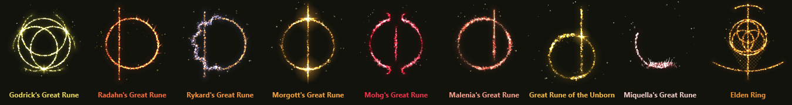

# SmartNotes

Sticky notes for the Windows desktop.

**[Download for Windows (.zip)](https://github.com/OlfJD/SmartNotes/releases/latest/download/SmartNotes-win-x64.zip)**. Portable: extract and run `SmartNotes.exe`. Needs the [.NET 10 Desktop Runtime](https://dotnet.microsoft.com/download/dotnet/10.0).


## Features

- **Six themes**: Classic, Paper Sticky, Cyberpunk, Medieval, Elden Ring and Astral (a night sky with its own constellation on every note), each with its own fonts, icons, menus and tooltips. Choose them per note.
- **Stays on the desktop**: notes sit behind your apps, even after `Win + D`, or float on top if you prefer.
- **Three modes**: text, checklist (drag tasks to reorder) and copy snippets.
- **Magnetic docking**: notes snap together and move as a stack.
- **Spell check and autocorrect** in 12 languages.
- **English and German** interface.
- **48-hour trash** for deleted notes.
- **Quiet updates** that install in the background while you're away.

In the Elden Ring theme the colour picker offers nine Great Runes instead of colours:



<details>
<summary>Themed menus</summary>


</details>

## Shortcuts

| Keys | Action |
| --- | --- |
| `Win + Alt + N` | New note |
| `Win + Alt + D` | Show / hide all notes |
| `Ctrl + Shift + C` | Copy the note's content |
| `Alt` / `Ctrl` + drag | Move one note out of a stack |

## Build

```bash
git clone https://github.com/OlfJD/SmartNotes.git
cd SmartNotes
dotnet run
```

Needs the .NET 10 SDK. Pushing a `v*` tag publishes a release.

## License

MIT. Not affiliated with Elden Ring; all theme art is drawn in code.
