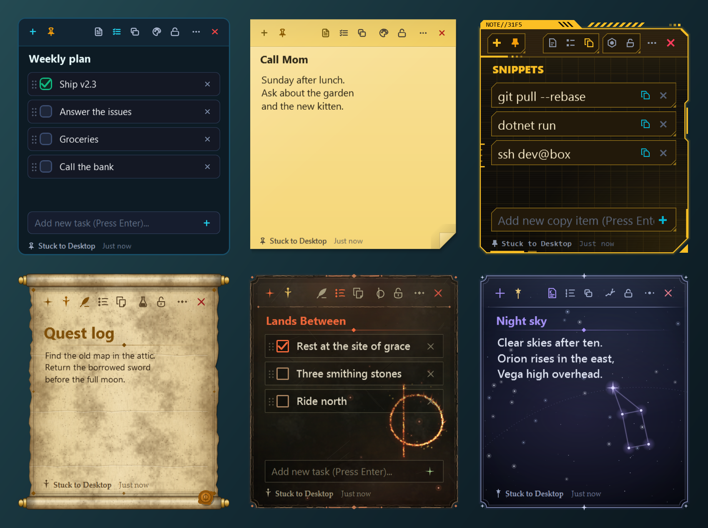

<div align="center">

# 📝 SmartNotes

**Desktop sticky notes for Windows: they live on your wallpaper, come in six themes, check your spelling and dock together magnetically.**

[-06B6D4?style=for-the-badge&logo=windows&logoColor=white)](https://github.com/OlfJD/SmartNotes/releases/latest/download/SmartNotes-win-x64.zip)
[](https://github.com/OlfJD/SmartNotes/releases/latest)
[](https://github.com/OlfJD/SmartNotes)
[](https://dotnet.microsoft.com/)

### 📥 [Download SmartNotes for Windows (.zip)](https://github.com/OlfJD/SmartNotes/releases/latest/download/SmartNotes-win-x64.zip)

*Portable app: no installation, extract and run. Updates itself quietly in the background.*

<br/>



</div>

---

## ⚡ Quick Start

1. **[Download the latest release (.zip)](https://github.com/OlfJD/SmartNotes/releases/latest/download/SmartNotes-win-x64.zip)**.
2. **Extract** it anywhere (e.g. `Documents\SmartNotes`).
3. Run **`SmartNotes.exe`**. It sits in the system tray; press `Win + Alt + N` for a new note.

Requires the [.NET 10 Desktop Runtime](https://dotnet.microsoft.com/download/dotnet/10.0) (Windows will offer to install it on first start if it is missing).

---

## 🎨 Six Note Themes

Every note can have its own theme. Pick it from the note's colour button (top bar) → **Note Style**.

| Theme | Look |
| :--- | :--- |
| **Classic** | Clean dark card in the note colour. 8 neon presets or any colour from the 2D picker. |
| **Paper Sticky** | A real paper sticky note: glue strip, folded corner, dark ink. |
| **Cyberpunk** | Black panel with cut corners, neon edges, scan grid and terminal fonts. |
| **Medieval** | Parchment scroll with rolled ends, an ink frame and old-world fonts. |
| **Elden Ring** | Dark, weathered menu panel with a pale-gold frame and a glowing **Great Rune**. |
| **Astral** | Night-sky panel with a clean ring and a silver frame. |

Each theme comes with **its own icon set and fonts**. You can change a theme's title and text font in **Settings → Note Appearance → Style Fonts** (20+ bundled fonts, including Cinzel, EB Garamond, Orbitron, VT323, IM Fell English, Grenze Gotisch and more).

### ✨ Great Runes (Elden Ring theme)

In the Elden Ring theme the colour picker becomes a **rune picker**: choose one of nine Great Runes, and the rune and its colour set the whole note's accents. Every rune is drawn by the app as glowing embers. No game artwork is shipped.


### 🧭 Themed menus and tooltips

The **"…" menu, the right-click menu, the colour popup and the button tooltips** follow the note's theme too: a gold-framed "Grace" menu in Elden Ring, cut-corner black and yellow in Cyberpunk, parchment in Medieval, a light sticky note in Paper Sticky and a starry panel in Astral. Classic keeps the dark blue menus.

<details>
<summary>Show all themed menus</summary>
<br/>

</details>

---

## 📌 Notes that live on your desktop

- **Desktop Stuck** (default): the note sits on the wallpaper layer behind your apps and never steals focus. It **stays visible when you press `Win + D` / Show Desktop**.
- **Always on Top**: the note floats above everything.
- Switch per note with the pin button in the top bar.

## 📝 Three note modes

1. **Text**: free text with auto-save and 1-click Markdown (`.md`) export.
2. **Checklist**: tasks with checkboxes, done/total progress and "Clear completed tasks". **Drag the ⋮⋮ grip on a task to reorder it.**
3. **Copy compartments**: snippet rows, each with a 1-click copy button.

## 🧲 Magnetic docking

- Drag notes next to each other to **snap them into stacks**.
- Drag the **top note** of a stack to move the whole stack; drag any other note to peel it off. Hold `Alt` or `Ctrl` to move a single note.

## ✍️ Spelling, autocorrect and smart symbols

- **Spell checking** in titles, text, tasks and snippets, with suggestions in the right-click menu.
- **12 proofing languages**: English (US/UK/CA/AU), German, Spanish, French, Italian, Portuguese, Dutch, Polish, Swedish.
- **Autocorrect** for 150+ common typos (`teh` → `the`, `dont` → `don't`). Press `Backspace` right after a fix to undo it.
- **Smart symbols**: `->` → `→`, `=>` → `⇒`, `!=` → `≠`, `--` → `—`, `(c)` → `©`.
- **Auto-capitalisation** of sentence starts and a standalone `i`.
- Add your own words from the right-click menu, or your own replacements in `%APPDATA%\SmartNotes\autocorrect_rules.json`.

## 🌍 English and German

The whole app (settings, menus, tray, dates such as *"Just now"* / *"Gerade eben"*) is available in English and German. The language follows Windows on first start and can be switched live in Settings.

## 🗑️ 48-hour trash

Deleted notes are kept for 48 hours. Restore one or all of them from the tray menu or from Settings.

## 🔄 Quiet automatic updates

SmartNotes checks GitHub for new releases in the background and downloads them silently. It **only restarts into the new version while you are away** (a few minutes without input, no note focused), and your notes are saved first. No pop-ups. **Check for Updates…** in the tray or note menu still checks on demand.

> Coming from **v2.1.0 or older**? Those versions only update when you click *Check for Updates…*. Do that once, and from then on updates are automatic.

## ⚡ Light on memory

Dictionaries and closed notes stay on disk until needed, and SmartNotes trims its memory while idle. **Settings → Memory & Performance** shows live usage and has a 1-click trim.

---

## ⌨️ Shortcuts

| Shortcut / action | What it does |
| :--- | :--- |
| `Win + Alt + N` | New note at the mouse position |
| `Win + Alt + D` | Show / hide all notes |
| `Ctrl + Shift + C` | Copy all content of the active note |
| `Enter` (checklist / copy mode) | Add a new task or snippet |
| Drag the ⋮⋮ grip (checklist) | Reorder tasks |
| `Backspace` right after an autocorrect | Undo the correction |
| Right-click on text | Spelling suggestions, cut / copy / paste, proofing options |
| Drag the top bar | Move the note (or its whole stack) |
| Drag an edge or corner | Resize |

---

## 🛠️ Under the hood

- **C# / WPF on .NET 10** (`net10.0-windows`, `win-x64`), per-monitor DPI aware.
- **`Core/Native/`**: desktop layering (`HWND_BOTTOM`, `WS_EX_TOOLWINDOW`), the Show Desktop watcher, global hotkeys, tray menu, memory trimming.
- **`Core/Services/`**: JSON storage in `%APPDATA%\SmartNotes\` (`notes.json`, `settings.json`), localisation, spell checking via the Windows `ISpellCheckerFactory`, the updater.
- **`UI/Skins/`**: each theme's note body is painted in code (`CyberpunkArt`, `EldenRingArt`, `RuneArt`, …); `UI/Themes/*Menu.xaml` holds the themed menus.
- Design references for the themes are in [`docs/references/`](docs/references/).

---

## 💻 Building from source

**Needs:** Windows 10/11 (64-bit) and the [.NET 10 SDK](https://dotnet.microsoft.com/download/dotnet/10.0).

```bash
git clone https://github.com/OlfJD/SmartNotes.git
cd SmartNotes
dotnet run
```

Release build:

```bash
dotnet publish SmartNotes.csproj -c Release -o release_output
```

Pushing a `v*` tag builds the release ZIP and publishes it on GitHub (`.github/workflows/release.yml`).

---

## 📄 License

SmartNotes is open-source software under the **MIT License**.

*Elden Ring is a trademark of its owners. SmartNotes is not affiliated with it; the theme and its runes are original drawings made in code.*
