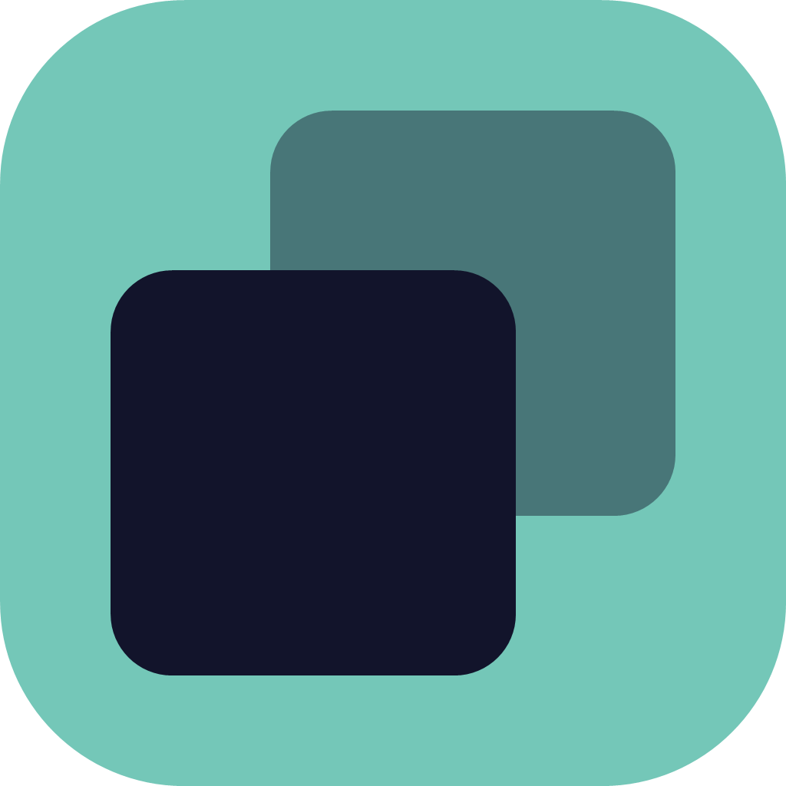
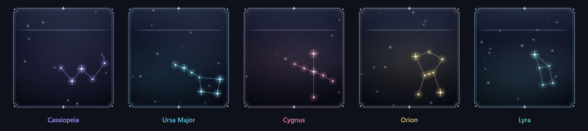
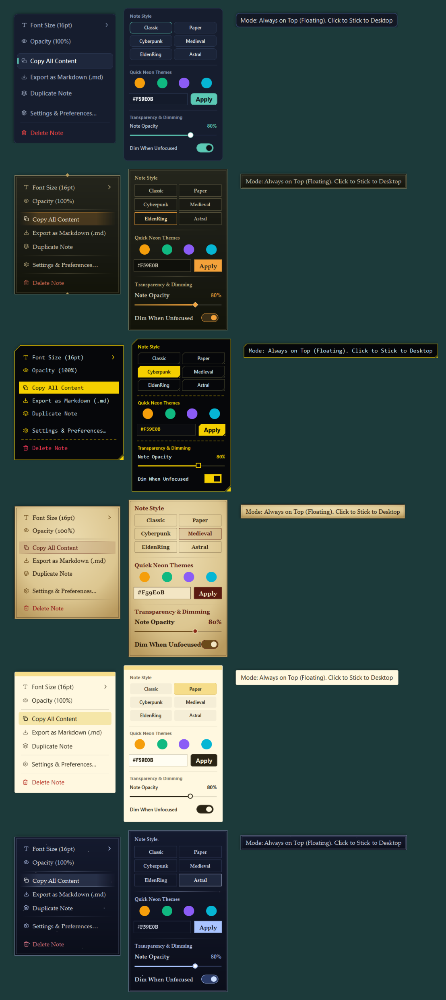

<div align="center">



# SmartNotes

Cool and unique free sticky notes for your Windows desktop.\
Notes, to-do lists and checklists right on your desktop. No account, no cloud, everything stays on your PC.

[**Download SmartNotes (.zip)**](https://github.com/OlfJD/SmartNotes/releases/latest/download/SmartNotes-win-x64.zip)

<br>


</div>

## How it works

- **Extract the zip and run `SmartNotes.exe`**. Your notes stick to the desktop, behind your apps, and stay visible after `Win + D`.
- **Top of a note**: **+** for a new note, the pin to keep it on top, text / checklist / copy-snippet mode, colours and themes, the lock, and **···** for font size, transparency, spell check, export and settings.
- **Tray icon**: click it (or press `Win + Alt + A`) to bring all notes to the front, right-click for new note, show / hide all, arrange, the 48-hour trash, settings and exit.

## Features

- **Ten themes**: Classic, Paper Sticky, Cyberpunk, Medieval, Elden Ring (nine Great Runes instead of colours), Astral (a constellation on every note), Terminal (phosphor in your note colour, `[x]` ticks, a blinking cursor), Blueprint (the title sits in a drawing title block), Ink & Washi (rice paper and a red name seal with your title's first letter) and Deep Sea (a glowing jellyfish, anglerfish or nautilus on every note), each with its own fonts and menus. Switch on **Living Themes** in Settings for small animations while you work in a note: shooting stars, a breathing rune, a glitch on save, a wax seal on locked scrolls.
- **Three modes**: text, checklist (drag tasks to reorder, done tasks are struck through, "3/7" shows your progress) and copy snippets.
- **Reminders**: *Remind Me* in the **···** menu (in an hour, this evening, tomorrow morning, or any day and time, once or repeating). The note then comes forward over your apps and glows until you tick it off or snooze it.
- **Daily checklists**: *Repeat Daily* unticks the tasks every morning, and a flame counts the days in a row you got everything done.
- **Notes for one program**: *Show Only With* in the **···** menu links a note to a program. It then floats over that program only while it's in front (key bindings over a game, snippets over your editor) and hides otherwise. `Win + Alt + A` still brings it forward.
- **Magnetic docking**: notes snap together and move as a stack.
- **Lock a note** so it can't be edited, moved or deleted by accident.
- **Export** a note as Markdown, copy all of it with `Ctrl + Shift + C`, or **copy it as a picture** to share it in a chat.
- **Several screens**: a note left on an unplugged monitor comes back onto a visible one, and *Arrange notes* keeps your sizes and docked stacks.
- **Spell check** in 12 languages, plus autocorrect and your own text shortcuts.
- **Safe saving**: every change is saved right away. If a save fails, the note says so and tries again. Notes are backed up before every update, and **earlier versions** of each note can be brought back from its **···** menu.
- **Quiet updates** in the background, **English and German**, and it **starts with Windows** (turn that off in the tray menu or Task Manager).

## Runes and constellations

In the Elden Ring theme the colour picker offers nine Great Runes instead of colours:


In the Astral theme every note gets its own constellation, picked automatically or chosen by you:



<details>
<summary>Themed menus</summary>



</details>

## Shortcuts

| Keys | Action |
| --- | --- |
| `Win + Alt + N` | New note |
| `Win + Alt + A` | Bring all notes to the front |
| `Win + Alt + S` | Show / hide all notes |
| `Ctrl + Shift + C` | Copy the note's content |
| `Alt` / `Ctrl` + drag | Move one note out of a stack |

## Where are my notes?

In `%AppData%\SmartNotes` (`notes.json`). Copy that folder to back up your notes or move them to another PC.

## Requirements

Windows 10 or 11 with the [.NET 10 Desktop Runtime](https://dotnet.microsoft.com/download/dotnet/10.0) (x64).

## Building

```bash
git clone https://github.com/OlfJD/SmartNotes.git
cd SmartNotes
dotnet run
```

Needs the .NET 10 SDK. Tests: `dotnet run --project tests/SmartNotes.Tests` (see [tests/README.md](tests/README.md)). Pushing a `v*` tag publishes a release. Development notes are in [DEVLOG.md](DEVLOG.md).

MIT license. Not affiliated with Elden Ring; all theme art is drawn in code.
